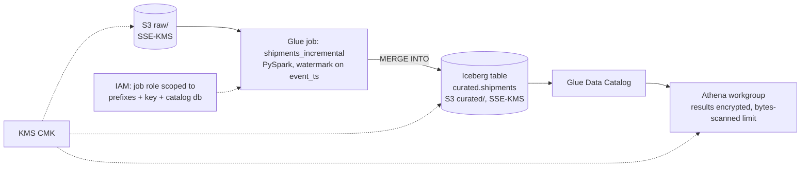

# aws-glue-iceberg-terraform

 

Terraform for an AWS data lake: S3 raw and curated zones encrypted with a KMS key, the Glue Data Catalog, an incremental Glue PySpark job that merges into an Apache Iceberg table, an Athena workgroup and least-privilege IAM. CI validates and plans everything against LocalStack, so no AWS credentials are ever needed.

> Fictional company: **Gulf Freight Co.**, shipment events landing daily as JSON.

## Architecture


## Run it in three commands
```bash
make test        # pytest: Glue job transform logic on local PySpark (no AWS)
make validate    # terraform fmt -check, validate, tflint
make plan-local  # terraform plan against LocalStack (docker compose)
```
Deploying to a real AWS account is optional and documented in `docs/deploy.md` (`terraform apply` with your own profile). That step incurs cost and is not part of CI.

## What is inside
```
terraform/
  modules/{s3_zone,kms,glue_catalog,glue_job,athena,iam}
  envs/dev/{main.tf,variables.tf,providers.tf,localstack.tf}
glue_jobs/shipments_incremental.py   # pure transform functions + thin Glue entrypoint
tests/                               # transform tests on local SparkSession
.github/workflows/ci.yml             # fmt, validate, tflint, plan vs LocalStack, pytest
```

## Security choices
- One customer-managed KMS key with rotation enabled. The bucket policies deny unencrypted puts and non-TLS access.
- The Glue job role can read only `raw/shipments/*`, write only `curated/shipments/*`, use only its key and touch only its catalog database. No `*` actions.
- The Athena workgroup enforces encrypted results and a per-query scan limit.

## What it proves
- AWS data engineering in Terraform with security built in, not bolted on
- Incremental processing (watermark + `MERGE`) into Iceberg
- Credential-free CI for infrastructure code

## Limitations
- LocalStack coverage for Glue and Athena is partial. The plan is checked, but jobs do not run in CI; their logic is unit-tested separately.
- Each zone is its own bucket, so "`raw/shipments/*`" means the `shipments/` prefix of the raw bucket (same for curated).
- The end-to-end `MERGE INTO` test against a real local Iceberg table is opt-in (`ICEBERG_IT=1`, set in CI) because it downloads the Iceberg runtime jar; the default `make test` covers the transforms and the generated SQL without it.
- Terraform creates the Iceberg table unpartitioned (the Glue API cannot express hidden partitioning); add `days(event_ts)` with `ALTER TABLE ... ADD PARTITION FIELD` if volumes justify it.
- Glue CloudWatch log encryption is left off; enabling it needs an extra key-policy grant for the CloudWatch Logs service.

## About the author
Built by Gopi Dodda, Senior Data Engineer: [LinkedIn](https://www.linkedin.com/in/gopidodda6091/). Original work on synthetic data.
